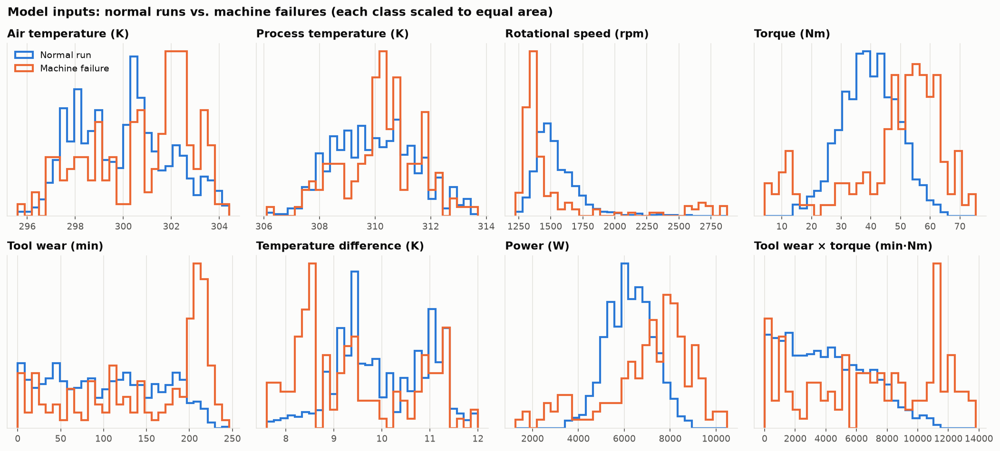
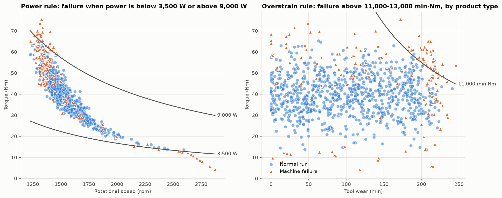
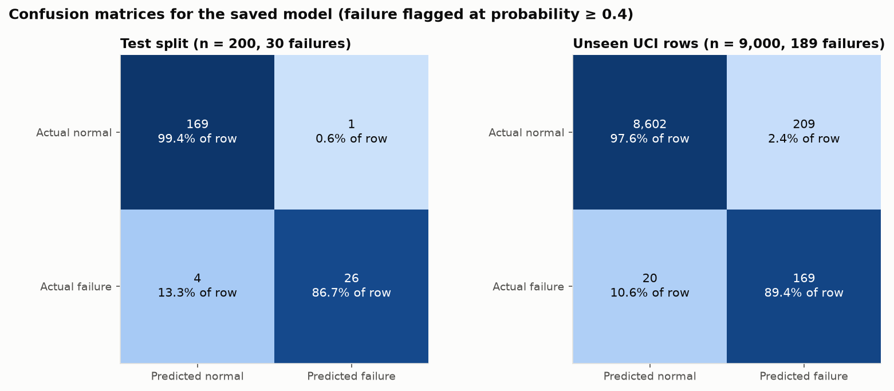
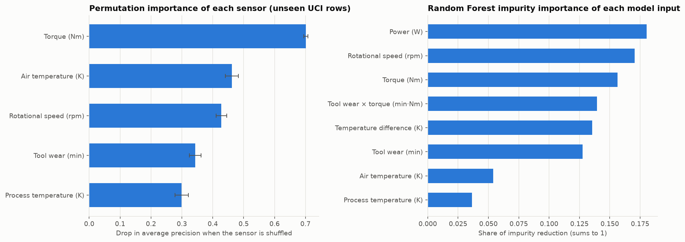

# EDA and Evaluation Report

These are the figures and tables for the saved Track 1 model, `models/defect_pipeline.joblib`, with how to read each one. To regenerate everything in `reports/`, run this from the repo root:

```bash
python3 src/report.py
```

All numbers below come from that run (3 Nov 2026). A run counts as a failure when the model's failure probability is 0.4 or more (`FAILURE_THRESHOLD` in `src/pipeline.py`).

> [!IMPORTANT]
> AI4I 2020 is a synthetic benchmark, and its failure label comes from published rules on these same sensors. These figures show how well a model recovers those rules. They don't show real-factory performance. See [DATASET_CARD.md](DATASET_CARD.md).

| File | What it shows | Data |
| :--- | :--- | :--- |
| `reports/eda_sensor_distributions.png` | Each model input, normal runs vs. failures | All 1,000 rows |
| `reports/eda_failure_rules.png` | Two UCI failure rules drawn over the data | All 1,000 rows |
| `reports/confusion_matrix.png` | Correct and wrong predictions, in counts and shares | Test split and unseen rows |
| `reports/classification_report.txt` | Precision, recall and F1 for each class | Test split and unseen rows |
| `reports/feature_importance.png` and `.csv` | Which sensors and inputs the model relies on | Unseen rows, and the fitted forest |
| `reports/metrics.json` | Precision, recall, F1, accuracy and confusion matrix per set, read by the Streamlit app | Train split, test split and unseen rows |

**Test split:** the 200 rows of `manufacturing_samples.csv` held out from training (30 failures). **Unseen rows:** the 9,000 raw UCI rows outside that file (189 failures, 2.10%). Both are used for reporting only, never for choosing models or thresholds. The unseen rows are new rows from the same synthetic UCI generator, not independent real-world data, so they test generalization to new rows from the same rules. The train split (800 rows) appears only in `metrics.json`, where perfect scores show the forest fits its training data; they say nothing about performance.

---

## 1. Sensor distributions



Each panel shows one of the eight model inputs: the five UCI sensors on top, and the three features the pipeline derives from them below. Each class is scaled to the same area, so the 150 failures compare fairly with the 850 normal runs. Look for places where the orange line sits away from the blue one.

- **Rotational speed:** failures pile up below about 1,400 rpm, with a second small group above 2,500 rpm.
- **Torque:** failures sit at both ends, mostly above 45 Nm, with a smaller group below 20 Nm.
- **Tool wear:** failures jump between 200 and 240 min, where UCI's random tool-wear failures happen.
- **Temperature difference:** many failures fall below 8.6 K, the heat-dissipation limit.
- **Power and tool wear × torque:** these separate failures more cleanly than any single sensor. That's why the pipeline adds them.
- **Air and process temperature:** on their own, these overlap heavily. They matter through their difference.

## 2. Failure rules



Both panels draw a UCI rule from [DATASET_CARD.md](DATASET_CARD.md) §2b over the data. Blue circles are normal runs, and orange triangles are failures.

- **Left, power rule:** the two curves are 3,500 W and 9,000 W, where power = torque × rpm × 2π/60. Every run outside them is a failure. Failures between the curves come from the other failure modes.
- **Right, overstrain rule:** the curve is tool wear × torque = 11,000 min·Nm, the lowest limit. The real limit is 11,000, 12,000 or 13,000 depending on product type, which this dataset doesn't include. Failures cluster above the curve at high tool wear.

These curved boundaries are hard for trees to find from raw sensors. The derived power and strain features turn them into a single cut.

## 3. Confusion matrix



Rows are the actual outcome and columns are the prediction. Each cell shows the count and its share of the row. Darker cells hold a larger share of their row.

| | Test split (n = 200) | Unseen rows (n = 9,000) |
| :--- | :---: | :---: |
| Failures caught | 26 of 30 (86.7%) | 169 of 189 (89.4%) |
| Failures missed | 4 | 20 |
| False alarms | 1 of 170 normal runs (0.6%) | 209 of 8,811 normal runs (2.4%) |

On unseen rows, false alarms outnumber caught failures: 209 against 169. A false-alarm rate of only 2.4% still produces many false alarms, because normal runs are about 47 times more common than failures there.

## 4. Classification report

`reports/classification_report.txt` holds sklearn's per-class report for both sets. The failure rows are the ones that matter:

| Set | Failure precision | Failure recall | Failure F1 | Accuracy |
| :--- | :---: | :---: | :---: | :---: |
| Test split | 0.963 | 0.867 | 0.912 | 0.975 |
| Unseen rows | 0.447 | 0.894 | 0.596 | 0.975 |

- **Precision:** of the runs flagged as failures, the share that really failed. It falls from 0.963 to 0.447 on unseen rows because failures are far rarer there (2.10% against 15% in the training file).
- **Recall:** of the real failures, the share the model caught. It holds steady across both sets.
- **Accuracy:** it's 0.975 for both sets, so it hides the precision drop. Use the failure rows instead.
- **Macro average:** the plain average of both classes. The unseen rows score 0.791 F1, lower than the 0.987 F1 for normal runs, which shows that failures are the weak spot.

## 5. Feature importance



The two panels answer different questions, so they don't agree on the order.

**Left, permutation importance.** This shows how much worse the model ranks failures when one sensor's values are shuffled across the unseen rows. It's measured as the drop in average precision, which ranges from 0 to 1, with 10 shuffles per sensor. The error bars show the spread across shuffles. Shuffling a sensor also breaks every feature derived from it, so this shows each sensor's full value.

| Sensor | Drop in average precision |
| :--- | :---: |
| Torque | 0.701 ± 0.007 |
| Air temperature | 0.462 ± 0.021 |
| Rotational speed | 0.428 ± 0.017 |
| Tool wear | 0.344 ± 0.019 |
| Process temperature | 0.299 ± 0.022 |

- **Torque matters most:** it feeds both power and tool wear × torque.
- **Every sensor matters:** each drop is large. The failure rules combine sensors, so losing any one breaks at least one rule.

**Right, impurity importance.** This shows how much each of the eight model inputs reduced uncertainty in the forest's splits during training. The shares sum to 1.

- **Top inputs:** power (0.180) and rotational speed (0.171).
- **Middle group:** torque (0.156), tool wear × torque (0.139), temperature difference (0.136) and tool wear (0.128).
- **Least used:** air temperature (0.054) and process temperature (0.036). The forest mostly uses them through their difference.

Impurity importance comes from training data and splits credit between related inputs, such as torque and power. Permutation importance on unseen rows is the better guide to what the model needs.

---

## Track 2 EDA (generated dimensions)

`manufacturing_visualizations.py` writes `manufacturing_dimension_boxplots.png` and `manufacturing_scatter_plot.png`, and `manufacturing_visualisation.py` writes `manufacturing_quality_scatter.png`. They plot the dimensions this project generated, not real measurements. The dashed and dotted lines show the label rule: |tolerance deviation| > 0.12 mm or |weight − 250| > 7 g.

Some defective triangles sit inside both limits. Those 18 parts are defective only through the machine-failure part of the rule, which the dimensions can't show. The 8 parts with missing weight aren't plotted.
